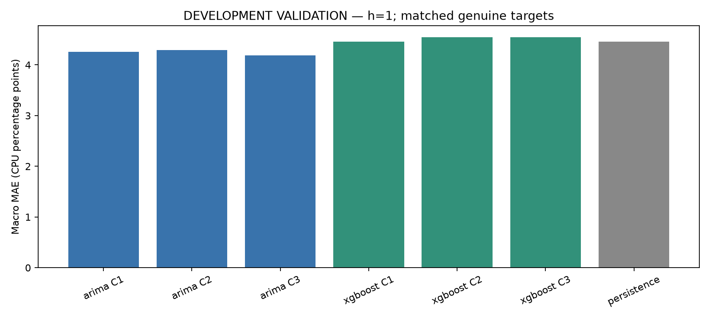
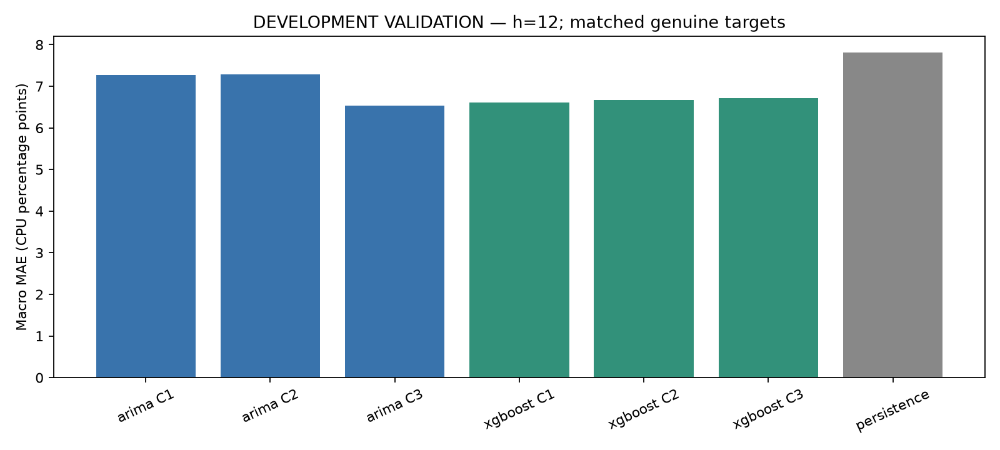

# M3B-2 comparative results — DEVELOPMENT VALIDATION

Prespecified candidates were trained separately per machine on fit indices [0,864) and streamed through validation [864,1152). No later research block or confirmation observations were used. Candidate selection is development tuning, so these are not independent final-test results.

## Selected settings

The frozen equally weighted macro h=1 MAE rule selected ARIMA C3, order (1,1,1), and XGBoost C1, max_depth=2, n_estimators=100, learning_rate=0.05. XGBoost uses separate direct h=1/h=12 regressors. Both horizons retain those same selected configurations. Selection was designated only after all 18 replays; earlier issued forecasts were not rewritten.

All nine ARIMA fits converged with finite objectives/parameters, positive variance and accepted AR/MA roots. All eighteen XGBoost horizon fits completed. There were zero captured fit warnings, rejected fits, or numerical update/forecast failures. All three candidates per family remained eligible for global selection. AIC was logged but never used for selection.

## Expert-only comparisons on identical genuine targets

| Model | h | Genuine pairs summed over machines | Macro MAE | Macro RMSE |
|---|---:|---:|---:|---:|
| Persistence | 1 | 696 | 4.454725 | 6.037374 |
| ARIMA (1,1,1) | 1 | 696 | 4.184956 | 5.652008 |
| XGBoost C1 | 1 | 696 | 4.458352 | 6.099749 |
| Persistence | 12 | 670 | 7.809454 | 10.067045 |
| ARIMA (1,1,1) | 12 | 670 | 6.538153 | 8.640194 |
| XGBoost C1 | 12 | 670 | 6.612528 | 8.823394 |

Units are CPU percentage points. Macro values are arithmetic means of three per-machine metrics, not pooled-error estimates. Pair counts are not independent samples: horizons overlap and machines share a cluster.

No numerical fallback occurred at eligible origins, so common-gate policy and expert-only metrics coincide in this run. The persistence rows use exactly the same origin/target pairs. On h=1, selected ARIMA has lower observed macro MAE than persistence, while selected XGBoost is slightly worse than persistence. At h=12 both selected models have lower observed macro MAE than persistence. This does not establish statistical significance, general superiority or a DAF-R gain.

| Machine | h | Matched genuine pairs | Persistence MAE / RMSE | ARIMA C3 MAE / RMSE | XGBoost C1 MAE / RMSE |
|---|---:|---:|---:|---:|---:|
| m_505 | 1 | 206 | 4.3599 / 6.2002 | 4.1245 / 5.7075 | 4.2086 / 5.7849 |
| m_505 | 12 | 204 | 7.3617 / 9.6595 | 5.9590 / 8.1238 | 5.9956 / 8.4011 |
| m_1426 | 1 | 236 | 4.7379 / 6.1733 | 4.4986 / 5.8459 | 4.6335 / 6.1646 |
| m_1426 | 12 | 224 | 8.6255 / 10.6960 | 7.1297 / 8.7715 | 7.3701 / 8.9268 |
| m_3028 | 1 | 254 | 4.2664 / 5.7386 | 3.9318 / 5.4026 | 4.5330 / 6.3497 |
| m_3028 | 12 | 242 | 7.4411 / 9.8456 | 6.5257 / 9.0253 | 6.4719 / 9.1423 |

XGBoost is worse than persistence at h=1 on m_3028; unfavorable outcomes are retained.

## Complete policies, including history-gate fallback

| Policy | h | Genuine scored pairs summed over machines | Macro MAE | Macro RMSE |
|---|---:|---:|---:|---:|
| Persistence | 1 | 851 | 4.313869 | 5.787482 |
| ARIMA + fallback | 1 | 851 | 4.090864 | 5.463836 |
| XGBoost + fallback | 1 | 851 | 4.327306 | 5.862603 |
| Persistence | 12 | 818 | 7.523822 | 9.783325 |
| ARIMA + fallback | 12 | 818 | 6.493249 | 8.618470 |
| XGBoost + fallback | 12 | 818 | 6.552322 | 8.767481 |

These rows cover more origins than the expert-only table. Compare policies within this table rather than claiming gains by crossing different denominators.

For each selected model, the same availability counts apply; both horizons have 288 origin decisions per machine:

| Machine | Expert predictions per h | Persistence fallbacks per h | Abstentions | Expert genuine pairs h1 / h12 | Complete-policy genuine pairs h1 / h12 | Missing targets per h | Complete-policy pending h1 / h12 |
|---|---:|---:|---:|---:|---:|---:|---:|
| m_505 | 209 | 79 | 0 | 206 / 204 | 282 / 271 | 5 | 1 / 12 |
| m_1426 | 239 | 49 | 0 | 236 / 224 | 284 / 273 | 3 | 1 / 12 |
| m_3028 | 256 | 32 | 0 | 254 / 242 | 285 / 274 | 2 | 1 / 12 |

Persistence itself issued at all 288 origins per horizon/machine. Fallbacks above are due to the shared history gate, not numerical failure. Pending tails remain unscored, and missing targets have no errors or coverage outcomes.

Across all 18 candidate replays, including each trial's persistence reference, the audit contains 20,736 immutable issued decisions: 20,028 genuine scores, 240 unavailable targets and 468 pending tails, with zero abstentions. Repeated persistence references and candidate forecasts must not be treated as independent replications.

## Files and figures

- validation_metrics.csv and metrics.json: every candidate, machine and horizon, including matched-origin expert accuracy, complete-policy accuracy, fallback/abstention/missing/pending counts and failures.
- fit_diagnostics.json: all candidate warnings, convergence, roots, likelihood/AIC and model artifact fingerprints.
- selection.json: the frozen h=1 global ranking and h=12 secondary status.
- matched_mae_h1.png and matched_mae_h12.png: all candidate common-gate MAEs and persistence on matching targets. Both plots were visually checked.

No confidence interval, significance test, interval calibration, drift detection or adaptive model-selection result is claimed. This is a fixed-model development pilot.

